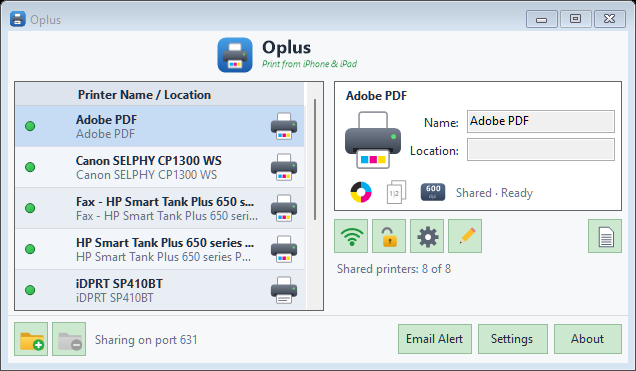

# Oplus

Print from iPhone and iPad to any Windows printer, or save straight to a folder or Dropbox.

Oplus shares the printers on your PC over AirPrint-style IPP + Bonjour (mDNS), so they show up
in the iOS print dialog with no app or driver on the phone. No Bonjour install, no licence key,
no activation.



## Download

Get `Oplus.exe` from the [latest release](https://github.com/muleskin/Oplus/releases/latest).
It's one self-contained file for 64-bit Windows, so you don't need to install .NET. Download it and run it.

Windows Firewall will ask to allow Oplus on your network the first time: allow it on private
networks so phones can find the printers.

## What it does

- **Shares your Windows printers.** Each printer can be turned on or off for sharing, renamed,
  and given a location. Colour, duplex, paper and resolution come from the printer's driver.
- **Virtual printers.** *Save to Folder* and *Save to Dropbox* printers save each job as a PDF
  (or JPEG for photos) named `YYYYMMDD-hhmmss-mmm-<job>.pdf`.
- **Password per printer.** Optional user name and password (HTTP Basic) for any shared printer.
- **Log.** Every job is logged to `%LocalAppData%\Oplus\newlog.csv`; the Log button shows it as a table.
- **Email alerts** when a printer reports low toner, paper out, a jam, an open cover and so on.
- **Settings:** launch on startup, port 631 (falls back to 12631) or a custom port.
- Runs in the tray; `Oplus.exe /hide` starts minimised.

## Building

Needs the .NET 10 SDK on Windows.

```powershell
cd app
dotnet run                                          # run from source
dotnet publish -p:PublishProfile=SingleExe          # single self-contained exe in app\publish\Oplus.exe
```

C# WinForms with its own IPP server, URF raster decoder, PDF writer and mDNS responder; no
extra packages. The protocol values and rules are in [app/MECHANICS.md](app/MECHANICS.md).
